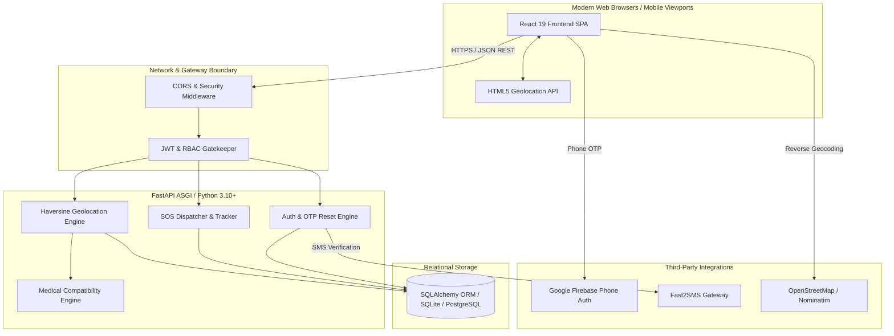
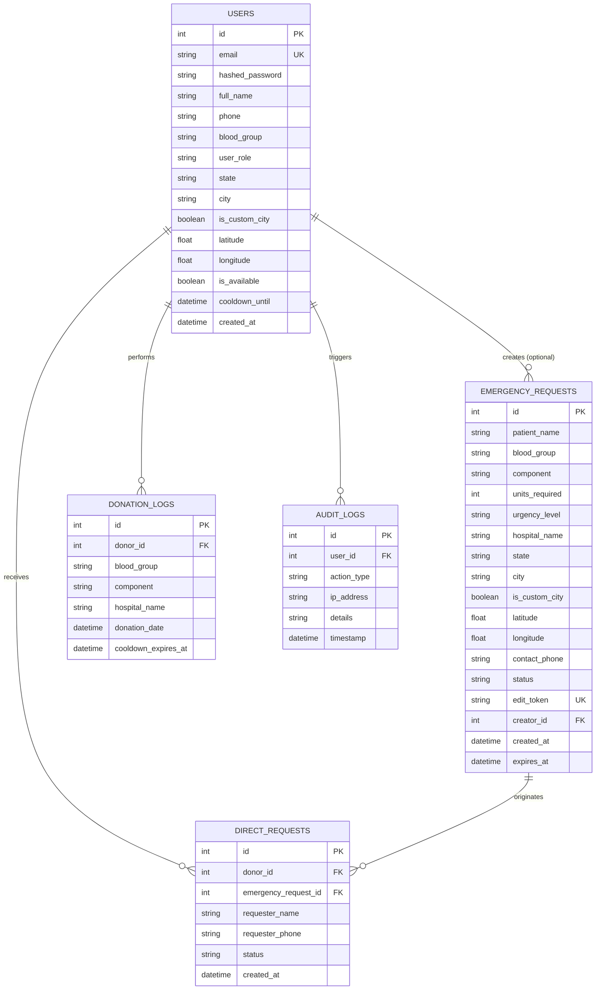
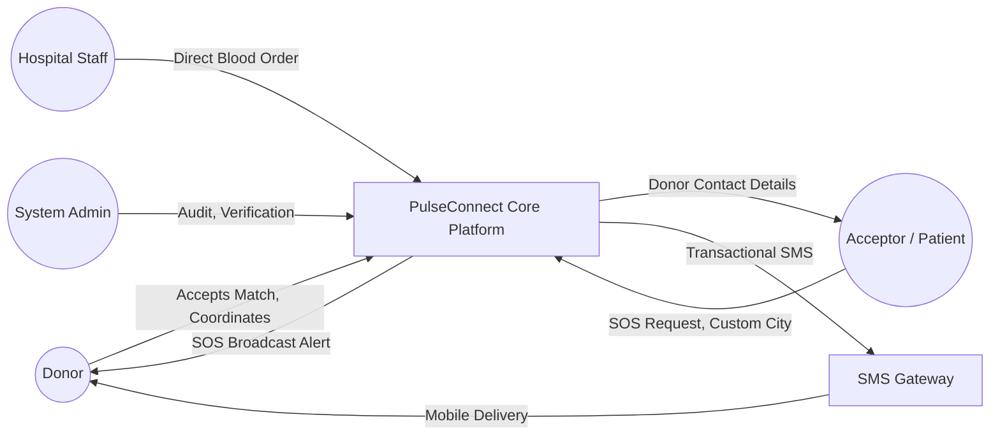
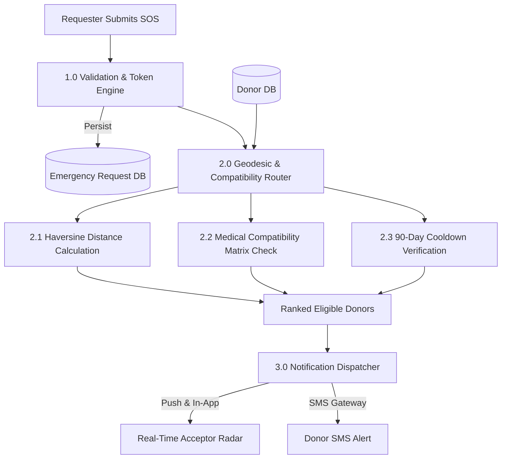

# 📄 Software Requirements Specification (SRS)
## PulseConnect: Hyper-Local Emergency Blood Donor Matching & SOS Broadcasting Platform

---

### **Document Control & Metadata**
- **Document Title:** Software Requirements Specification for PulseConnect (Blood Donor Connect)
- **Standard Adherence:** IEEE Std 830-1998 / ISO/IEC/IEEE 29148:2018
- **Document Version:** 1.0.0
- **Status:** Approved / Production Baseline
- **Date:** October 2026
- **Prepared For:** PulseConnect Core Engineering Team, Stakeholders & Healthcare Integrators
- **Classification:** Public Technical Specification

---

## 📑 Table of Contents
1. [1. Introduction](#1-introduction)
   - [1.1 Purpose](#11-purpose)
   - [1.2 Document Conventions](#12-document-conventions)
   - [1.3 Intended Audience & Reading Suggestions](#13-intended-audience--reading-suggestions)
   - [1.4 Project Scope & Objectives](#14-project-scope--objectives)
   - [1.5 Definitions, Acronyms & Abbreviations](#15-definitions-acronyms--abbreviations)
   - [1.6 References & Regulatory Standards](#16-references--regulatory-standards)
2. [2. Overall Description](#2-overall-description)
   - [2.1 Product Perspective & Context](#21-product-perspective--context)
   - [2.2 Product Functions Overview](#22-product-functions-overview)
   - [2.3 User Classes & Personas](#23-user-classes--personas)
   - [2.4 Operating Environment](#24-operating-environment)
   - [2.5 Design & Implementation Constraints](#25-design--implementation-constraints)
   - [2.6 Assumptions & Dependencies](#26-assumptions--dependencies)
3. [3. System Features & Functional Requirements](#3-system-features--functional-requirements)
   - [3.1 FR-01: User Authentication & Role-Based Access Control (RBAC)](#31-fr-01-user-authentication--role-based-access-control-rbac)
   - [3.2 FR-02: Self-Service Password Recovery & OTP Verification](#32-fr-02-self-service-password-recovery--otp-verification)
   - [3.3 FR-03: Emergency SOS Broadcasting & Dispatch](#33-fr-03-emergency-sos-broadcasting--dispatch)
   - [3.4 FR-04: Geolocation-Aware Proximity Search & Haversine Engine](#34-fr-04-geolocation-aware-proximity-search--haversine-engine)
   - [3.5 FR-05: Medical Blood & Blood Product Compatibility Engine](#35-fr-05-medical-blood--blood-product-compatibility-engine)
   - [3.6 FR-06: Pan-India Dynamic Location & Custom City Engine](#36-fr-06-pan-india-dynamic-location--custom-city-engine)
   - [3.7 FR-07: Direct Blood Requests & One-on-One Matching](#37-fr-07-direct-blood-requests--one-on-one-matching)
   - [3.8 FR-08: Donor Duty Lifecycle & 90-Day Medical Cooldown](#38-fr-08-donor-duty-lifecycle--90-day-medical-cooldown)
   - [3.9 FR-09: Privacy Preservation & Donor Contact Masking](#39-fr-09-privacy-preservation--donor-contact-masking)
   - [3.10 FR-10: Request Lifecycle & Real-Time Tracking](#310-fr-10-request-lifecycle--real-time-tracking)
   - [3.11 FR-11: Multi-Channel SMS & Push Notification Engine](#311-fr-11-multi-channel-sms--push-notification-engine)
   - [3.12 FR-12: Administrative Moderation, Verification & Audit Trail](#312-fr-12-administrative-moderation-verification--audit-trail)
4. [4. External Interface Requirements](#4-external-interface-requirements)
   - [4.1 User Interfaces (UI/UX)](#41-user-interfaces-uiux)
   - [4.2 Hardware Interfaces](#42-hardware-interfaces)
   - [4.3 Software Interfaces](#43-software-interfaces)
   - [4.4 Communications Interfaces](#44-communications-interfaces)
5. [5. Non-Functional Requirements (NFRs)](#5-non-functional-requirements-nfrs)
   - [5.1 Performance Requirements](#51-performance-requirements)
   - [5.2 Reliability & High Availability](#52-reliability--high-availability)
   - [5.3 Safety & Transfusion Guardrails](#53-safety--transfusion-guardrails)
   - [5.4 Security & Cryptographic Integrity](#54-security--cryptographic-integrity)
   - [5.5 Usability & Accessibility](#55-usability--accessibility)
   - [5.6 Maintainability & Portability](#56-maintainability--portability)
6. [6. Data Models, Architecture & Mathematical Specifications](#6-data-models-architecture--mathematical-specifications)
   - [6.1 Entity-Relationship (ER) Architecture](#61-entity-relationship-er-architecture)
   - [6.2 Data Flow Diagrams (DFD)](#62-data-flow-diagrams-dfd)
   - [6.3 Mathematical Geodesic Algorithm (Haversine Formula)](#63-mathematical-geodesic-algorithm-haversine-formula)
   - [6.4 Blood Compatibility Truth Tables](#64-blood-compatibility-truth-tables)
7. [7. Traceability Matrix & Appendices](#7-traceability-matrix--appendices)

---

## 1. Introduction

### 1.1 Purpose
This document specifies the complete software requirements for **PulseConnect (Blood Donor Connect)**, a responsive, hyper-local, and privacy-preserving emergency blood donor matching and SOS broadcasting platform. 

The primary purpose of PulseConnect is to dramatically reduce the critical turnaround time between a medical blood requirement and voluntary donor mobilization in India. It replaces fragmented social-media distress posts with an algorithmically verified matching engine that respects biological compatibility, donor health cooldowns, and user privacy.

### 1.2 Document Conventions
- **Requirement Identifiers:** Functional Requirements are designated as `[FR-XX]`. Non-Functional Requirements are designated as `[NFR-XX]`.
- **Priority Scale:**
  - **P0 (Critical / Mandatory):** Essential for system operation; emergency safety hazard if missing.
  - **P1 (High):** Core functionality required for complete user experience.
  - **P2 (Medium / Nice-to-Have):** Value-add enhancements that improve usability or operational analytics.
- **Terminology Standard:** Requirement statements follow RFC 2119 keywords:
  - **SHALL / MUST:** Absolute mandatory requirement.
  - **SHOULD:** Recommended guideline unless justified by architectural trade-offs.
  - **MAY:** Optional feature.

### 1.3 Intended Audience & Reading Suggestions
1. **Software Engineers & Full-Stack Developers:** Implement backend endpoints, database schemas, and frontend interfaces as defined in Sections 3, 4, and 6.
2. **Quality Assurance (QA) & Test Engineers:** Derive test cases, acceptance criteria, and load-testing boundaries from Sections 3, 5, and 7.
3. **Medical Coordinators & Hospital Administrators:** Review clinical workflow constraints, blood compatibility matrices, and cooldown rules in Section 3.5, 3.8, and 6.4.
4. **DevOps & Infrastructure Engineers:** Consult interface, security, and performance specifications in Sections 4 and 5 for hosting, scaling, and network provisioning.

### 1.4 Project Scope & Objectives
PulseConnect delivers an end-to-end web platform capable of:
1. **Instant SOS Broadcasting:** Enabling patients, hospital staff, or bystander family members to issue immediate emergency requests for Whole Blood, Red Cells, Platelets, or Fresh Frozen Plasma.
2. **Hyper-Local Geodesic Matching:** Locating verified active donors within a configurable geographical radius (5 km to 100+ km) using spherical trigonometry (Haversine Formula).
3. **Biological Transfusion Validation:** Enforcing strict ABO and Rhesus antigen cross-matching matrices for all 8 blood groups to prevent fatal transfusion errors.
4. **Zero-Friction Pan-India Accessibility:** Providing localized district navigation across all 36 States and Union Territories of India, coupled with custom city write-in engines for rural and remote locations.
5. **Donor Health Protection:** Enforcing a mandatory 90-day cooldown period following every successful donation.
6. **Anti-Harassment Privacy Controls:** Masking personal phone numbers behind cryptographic shields until a donor explicitly consents to fulfill a request.

### 1.5 Definitions, Acronyms & Abbreviations

| Term / Acronym | Definition |
| :--- | :--- |
| **ABO System** | The primary human blood grouping system based on the presence or absence of A and B antigens. |
| **Rh Factor** | Rhesus factor protein; presence ($+$) or absence ($-$) on red blood cell membranes. |
| **PRBC** | Packed Red Blood Cells; concentrated erythrocytes for acute blood loss. |
| **PRP / SDP** | Platelet Rich Plasma / Single Donor Platelets; essential for dengue, trauma, and cancer chemotherapy. |
| **FFP** | Fresh Frozen Plasma; liquid portion of blood containing clotting factors. |
| **SOS** | Save Our Souls; high-priority emergency distress broadcast. |
| **Haversine Formula** | Spherical trigonometry equation calculating great-circle distance between two GPS coordinates. |
| **RBAC** | Role-Based Access Control; security permission enforcement per user classification. |
| **JWT** | JSON Web Token (RFC 7519); compact, URL-safe means of representing claims between two parties. |
| **Bcrypt** | Key-derivation function based on Blowfish cipher for salting and hashing credentials. |
| **OTP** | One-Time Password; time-synchronized or HMAC-generated numeric authentication passcode. |
| **CORS** | Cross-Origin Resource Sharing; security mechanism restricting cross-domain HTTP queries. |
| **NBTC** | National Blood Transfusion Council (India); apex regulatory body governing voluntary blood donation. |

### 1.6 References & Regulatory Standards
- **IEEE Std 830-1998:** IEEE Recommended Practice for Software Requirements Specifications.
- **ISO/IEC/IEEE 29148:2018:** Systems and software engineering — Life cycle processes — Requirements engineering.
- **RFC 7519:** JSON Web Token (JWT) Standard.
- **RFC 2119:** Key words for use in RFCs to Indicate Requirement Levels.
- **National Blood Transfusion Council (NBTC), MoHFW Government of India:** Guidelines for Voluntary Blood Donation & Donor Cooldown Standards.
- **Digital Personal Data Protection (DPDP) Act 2023 (India):** Provisions governing sensitive personal and health information.

---

## 2. Overall Description

### 2.1 Product Perspective & Context
PulseConnect operates as an asynchronous, distributed web application. The frontend operates inside modern client web browsers (desktop, tablet, and smartphone), communicating over encrypted HTTPS with a high-throughput ASGI FastAPI backend. 



### 2.2 Product Functions Overview
1. **Donor Discovery & Matching:** Multi-faceted search filtering by Blood Group, Component, State, District, Custom City, and GPS Geodesic Radius.
2. **Emergency SOS Broadcast Pipeline:** Rapid single-form distress alert submission with automatic compatibility expansion, priority tagging, and creator token-based management.
3. **Direct Match Solicitation:** Direct request routing from recipients or hospitals to specific donors with real-time in-app status updates.
4. **Donor Management & Readiness:** Real-time online/offline duty toggles, live coordinate tracking, donation history recording, and automated cooldown timer locking.
5. **Security & Identity Protection:** Salted Bcrypt hashing, timed 6-digit OTP password reset, automated contact masking, and role-based route guards.
6. **Administrative Moderation:** Dashboard for hospital credential verification, distress request resolution, audit logging, and seed database generation.

### 2.3 User Classes & Personas

| User Role | Persona Description | Key Privileges & Responsibilities |
| :--- | :--- | :--- |
| **Guest / Acceptor** | Unauthenticated family member, bystander, or emergency recipient needing blood immediately. | - Search nearby donors.<br>- Post Emergency SOS requests.<br>- Modify/Cancel SOS via secret UUID4 edit token.<br>- View request status. |
| **Registered Donor** | Altruistic citizen registered as a potential blood donor. | - Manage profile, blood group, and medical availability.<br>- Toggle active/inactive duty status.<br>- Receive SOS broadcasts and direct requests.<br>- Accept/Reject requests (reveals phone number).<br>- Log completed donations (triggers 90-day cooldown). |
| **Hospital Coordinator** | Verified medical personnel or blood bank officer. | - Submit bulk or high-urgency blood requests.<br>- Verify donor arrival and successful donation.<br>- Access verified donor lists with emergency priority flags. |
| **System Administrator** | Technical platform operator / auditor. | - Moderate all active SOS broadcasts.<br>- Verify hospital certifications.<br>- Inspect system audit logs.<br>- Manage database seed profiles and regional coordinates. |

### 2.4 Operating Environment
- **Client Platforms:** Modern evergreen web browsers (Chromium 110+, Safari 16+, Firefox 115+, Microsoft Edge 110+). Responsive support for screen widths from 320px (mobile) to 3840px (4K desktop).
- **Backend Runtime:** Python 3.10 or higher running on Linux (Ubuntu 22.04 LTS), macOS, or Windows Server via ASGI Uvicorn.
- **Database Engine:** SQLite 3 for local edge/testing environments; PostgreSQL 15+ for enterprise clustering.
- **Network Environment:** TCP/IP stack over standard ports 80 (HTTP redirect) and 443 (HTTPS / TLS 1.3).

### 2.5 Design & Implementation Constraints
1. **Medical Compliance:** Blood matching algorithms must conform to standard immunohematological compatibility tables. No cross-group recommendation may contradict biological safety.
2. **Cooldown Guardrail:** The 90-day donor rest period is hardcoded in accordance with NBTC clinical norms and cannot be bypassed by donors.
3. **Stateless Scalability:** Authentication relies strictly on stateless signed JWT tokens; server nodes do not store session affinity state.
4. **Zero Forced Registration for Emergencies:** Emergency SOS posts must never be blocked by mandatory login walls. A bystander must be able to submit a distress request within 30 seconds.
5. **Bandwidth Efficiency:** Mobile-first payload optimization ensures functional execution over unstable 2G/3G/4G cellular networks across rural India.

### 2.6 Assumptions & Dependencies
- GPS coordinates retrieved from browser devices rely on hardware Wi-Fi/Cellular/GNSS sensors. Desktop devices without GNSS may experience ISP-level geocoding offset, necessitating manual State/District fallback.
- External SMS gateways (Fast2SMS, Twilio, Google Firebase) maintain active service uptime and regulatory compliance under Indian telecom routing standards.
- Donors maintain honest health self-reporting regarding infectious disease history, recent surgeries, and medication.

---

## 3. System Features & Functional Requirements

### 3.1 FR-01: User Authentication & Role-Based Access Control (RBAC)
- **Priority:** P0 (Critical)
- **Description:** The system must provide secure user registration, credential authentication, session management, and role-based privilege isolation.
- **Inputs:** Email, Password, Full Name, Phone Number, Blood Group, State, City/District, User Role (`donor_acceptor`, `hospital`, `admin`).
- **Processing:**
  1. Validate email syntax via RFC 5322 regex.
  2. Hash clear-text password with Bcrypt using a minimum cost factor of 12.
  3. Generate cryptographic JWT access token signed with HMAC-SHA256 containing `sub` (User ID), `role`, and `exp` claims.
  4. Enforce route-level authorization gates on protected API endpoints.
- **Outputs:** JWT Bearer token and sanitized user profile payload (excluding password hash).
- **Acceptance Criteria:** Unauthenticated requests to protected endpoints return HTTP 401 Unauthorized; unauthorized role requests return HTTP 403 Forbidden.

### 3.2 FR-02: Self-Service Password Recovery & OTP Verification
- **Priority:** P0 (Critical)
- **Description:** Users who have forgotten their credentials must be able to securely reset their password via a multi-stage One-Time Password (OTP) verification engine without administrator intervention.
- **Inputs:** Registered email address, 6-digit numeric OTP, new password string.
- **Processing:**
  1. Verify email existence in database.
  2. Generate a cryptographically random 6-digit numeric OTP with a 10-minute validity timestamp.
  3. Store hashed OTP and expiry timestamp in the user's security record.
  4. Dispatch OTP via SMS gateway (and system logging channel).
  5. Validate submitted OTP against stored hash and check current timestamp $\le$ expiry timestamp.
  6. Re-hash new password via Bcrypt and update the database record. Invalidate used OTP immediately.
- **Outputs:** HTTP 200 Success status code and confirmation message; invalid/expired OTP returns HTTP 400 Bad Request.
- **Acceptance Criteria:** Resetting password with an expired OTP fails; successfully resetting password allows immediate authentication with the new credential.

### 3.3 FR-03: Emergency SOS Broadcasting & Dispatch
- **Priority:** P0 (Critical)
- **Description:** Any user or guest must be able to publish an immediate emergency blood requirement distress broadcast to the network.
- **Inputs:** Patient Name, Blood Group, Blood Component (`Whole Blood`, `PRBC`, `Platelets`, `FFP`), Units Required, Urgency Level (`Critical < 2h`, `Urgent < 6h`, `Standard < 24h`), Hospital Name, State, City, Optional Custom City, Latitude/Longitude, Contact Number.
- **Processing:**
  1. Validate required fields and sanitize inputs.
  2. Generate a cryptographically unique UUID4 `edit_token` for guest author modification privileges.
  3. Persist record to database with status `ACTIVE`.
  4. Trigger asynchronous notification dispatch to matching registered donors within geographic proximity.
- **Outputs:** Persisted SOS record, public broadcast alert, and secret management token returned to creator.
- **Acceptance Criteria:** SOS broadcast appears on live feed within 500ms; pulsing visual priority badges render according to urgency tier.

### 3.4 FR-04: Geolocation-Aware Proximity Search & Haversine Engine
- **Priority:** P0 (Critical)
- **Description:** The system must locate and sort compatible donors based on spatial proximity calculated via the Haversine great-circle distance algorithm.
- **Inputs:** Target Latitude ($\phi_1$), Target Longitude ($\lambda_1$), Search Radius $R$ (in km: 5, 15, 25, 50, 100, or All), Requested Blood Group.
- **Processing:**
  1. Retrieve active, eligible donors who match the blood compatibility matrix.
  2. Compute geodesic distance $d$ between $(\phi_1, \lambda_1)$ and donor coordinates $(\phi_2, \lambda_2)$ using:
     $$d = 2r \arcsin\left(\sqrt{\sin^2\left(\frac{\phi_2 - \phi_1}{2}\right) + \cos(\phi_1)\cos(\phi_2)\sin^2\left(\frac{\lambda_2 - \lambda_1}{2}\right)}\right)$$
     where $r = 6371\text{ km}$.
  3. Filter out records where $d > R$ (unless radius is set to unlimited).
  4. Order results ascending by distance ($d$).
- **Outputs:** JSON array of matching donor profiles annotated with exact distance in kilometers.
- **Acceptance Criteria:** Search query completes in under 50ms for a dataset of 1,000+ donors; sorting accuracy verified to within 0.01 km precision.

### 3.5 FR-05: Medical Blood & Blood Product Compatibility Engine
- **Priority:** P0 (Critical)
- **Description:** The system must enforce biological transfusion compatibility rules across all 8 major blood groups ($O^-, O^+, A^-, A^+, B^-, B^+, AB^-, AB^+$) tailored to the specific blood component requested.
- **Component-Specific Rules:**
  - **Whole Blood / Packed Red Blood Cells (PRBC):**
    - $O^-$ is universal donor; $AB^+$ is universal recipient.
    - Rh-negative recipients can only receive Rh-negative blood.
  - **Platelets (PRP/SDP):**
    - Compatible across matching ABO antigens; cross-group permitted during critical shortages based on platelet plasma standards.
  - **Fresh Frozen Plasma (FFP):**
    - Plasma compatibility is inverted: $AB$ plasma has no ABO antibodies (universal plasma donor); $O$ recipients can receive any plasma group.
- **Outputs:** Boolean compatibility resolution (`true` or `false`) and list of compatible donor groups.
- **Acceptance Criteria:** System never displays an incompatible donor for a specific component request (e.g., $B^+$ donor never displayed for an $A^+$ Whole Blood request).

### 3.6 FR-06: Pan-India Dynamic Location & Custom City Engine
- **Priority:** P1 (High)
- **Description:** The platform must provide full geographic coverage of India, supporting all 36 States and Union Territories with district dropdowns, while allowing free-form custom city entry for unlisted towns or rural villages across every interface.
- **Inputs:** State selection, District selection, or Custom City text string.
- **Processing:**
  1. When a user selects a state, populate known districts and center coordinates.
  2. If the user selects `+ Other / Type Custom City...`, reveal a responsive text input field.
  3. Store custom city string alongside the state in user profile, SOS broadcasts, and direct requests.
  4. Seamlessly incorporate custom cities into keyword and regional text-match search indexes.
- **Outputs:** Normalized location representation `{ state, city, is_custom }`.
- **Acceptance Criteria:** User can register, update profile, search donors, and post an SOS using any custom village or town name in India without validation failure.

### 3.7 FR-07: Direct Blood Requests & One-on-One Matching
- **Priority:** P1 (High)
- **Description:** Requesters must be able to solicit a specific individual donor directly from search results without broadcasting publicly.
- **Inputs:** Target Donor ID, Requester Name, Phone Number, Patient Details, Hospital, Units Needed.
- **Processing:**
  1. Verify target donor is currently active and not in medical cooldown.
  2. Create a pending direct match transaction.
  3. Dispatch alert notification to the target donor's profile and mobile device.
  4. Await donor response (`ACCEPTED` or `REJECTED`).
- **Outputs:** Direct request record with real-time status tracker.
- **Acceptance Criteria:** Direct request appears in donor's incoming inbox within 1 second; donor action updates recipient UI asynchronously.

### 3.8 FR-08: Donor Duty Lifecycle & 90-Day Medical Cooldown
- **Priority:** P0 (Critical)
- **Description:** The platform must safeguard voluntary donor health by enforcing a mandatory 90-day physiological cooldown period following every successful blood donation.
- **Inputs:** Completed donation confirmation event, Date of donation ($T_D$).
- **Processing:**
  1. Record donation timestamp in `donation_history` log.
  2. Calculate cooldown expiration: $T_{Eligible} = T_D + 90\text{ days}$.
  3. Set user status `is_available = FALSE` and calculate remaining days:
     $$\text{Days Remaining} = \max\left(0, \left\lceil \frac{T_{Eligible} - T_{Current}}{86400} \right\rceil\right)$$
  4. Automatically exclude donor from search queries while $\text{Days Remaining} > 0$.
  5. Automatically reinstate eligibility once $T_{Current} \ge T_{Eligible}$.
- **Outputs:** Cooldown countdown badge in donor profile; exclusion from emergency donor pools.
- **Acceptance Criteria:** A donor with an active cooldown cannot be matched or solicited until 90 full calendar days have elapsed.

### 3.9 FR-09: Privacy Preservation & Donor Contact Masking
- **Priority:** P0 (Critical)
- **Description:** To prevent spam, harassment, and unauthorized aggregation of donor contact lists, phone numbers must remain masked until mutual consent is established.
- **Processing:**
  1. Public donor directories and search results display phone numbers with obscured digits:
     $$\text{Masked Format: } +91\ 98***\ ***11$$
  2. Full phone number ($+91\ 98765\ 43211$) is unlocked and revealed to requester *only after* the donor clicks "Accept Request".
  3. System administrators retain access to unmasked contact data for medical audit purposes.
- **Outputs:** Context-aware serialized JSON payload depending on viewer authorization and match state.
- **Acceptance Criteria:** Client web inspector cannot inspect unmasked phone number in raw search response payloads prior to match acceptance.

### 3.10 FR-10: Request Lifecycle & Real-Time Tracking
- **Priority:** P1 (High)
- **Description:** All SOS and direct blood requests must traverse a deterministic state machine with verifiable lifecycle tracking.
- **State Machine Model:**
  ```
  [PENDING] ---> [ACTIVE] ---> [IN_PROGRESS] ---> [FULFILLED]
                     |               |
                     v               v
                [EXPIRED]       [CANCELLED]
  ```
- **State Transitions:**
  - `PENDING`: Initial state upon creation awaiting verification.
  - `ACTIVE`: Broadcast live to network; matching donors alerted.
  - `IN_PROGRESS`: One or more donors have accepted; donor en route to blood bank.
  - `FULFILLED`: Hospital or requester confirms required units received.
  - `CANCELLED`: Requester or administrator cancels distress call.
  - `EXPIRED`: System automatically marks request expired after 24 hours without fulfillment.
- **Acceptance Criteria:** Status changes reflect across all connected client interfaces within 2 seconds.

### 3.11 FR-11: Multi-Channel SMS & Push Notification Engine
- **Priority:** P1 (High)
- **Description:** The system must bridge critical offline gaps by dispatching cellular SMS notifications to donors when high-priority emergencies occur nearby.
- **Supported Adapters:**
  - **Google Firebase Phone Auth:** Handles client-side OTP delivery with Google Invisible reCAPTCHA.
  - **Fast2SMS Gateway:** Indian domestic transactional SMS gateway for rapid direct dispatch.
  - **Twilio SMS Gateway:** Enterprise fallback for global message routing.
- **Payload Templates:**
  - *Emergency Alert:* `[PulseConnect] URGENT: B+ Blood needed at AIIMS BBSR (4.2 km from you). Click to accept: https://pulseconnect.org/sos/req-987`
  - *OTP Passcode:* `[PulseConnect] Your password reset code is 482910. Valid for 10 minutes. Do not share.`
- **Acceptance Criteria:** SMS delivery initiated within 3 seconds of high-urgency SOS event.

### 3.12 FR-12: Administrative Moderation, Verification & Audit Trail
- **Priority:** P2 (Medium)
- **Description:** Administrators must have oversight over platform operations to verify hospital registrations, resolve fraudulent distress calls, and audit sensitive data access.
- **Capabilities:**
  - View comprehensive platform metrics (total donors, active SOS alerts, units fulfilled).
  - Inspect system audit log recording actor IP address, user agent, timestamp, action type, and affected resource ID.
  - Delete or mark spam SOS broadcasts.
  - Verify and approve medical institution credentials.
- **Acceptance Criteria:** Every administrative action is permanently recorded in the immutable audit log table.

---

## 4. External Interface Requirements

### 4.1 User Interfaces (UI/UX)
- **Aesthetic Standard:** Modern, clinical, and high-trust user interface utilizing a rich medical dark/light palette (Crimson `#DC2626`, Rose `#F43F5E`, Slate `#0F172A`, Pure White `#FFFFFF`).
- **Typography:** Modern sans-serif typography (Inter, Outfit, or system-ui) optimized for legibility under high-stress conditions.
- **Key Screens:**
  1. **Landing & Real-Time Stats:** Hero banner with immediate Emergency SOS CTA, live donor counter, fulfilled units, and active emergency radar.
  2. **Donor Search Matrix:** Multi-filter query bar with Blood Group pills, Component dropdown, State/District picker, Custom City input, and Geodesic Radius slider.
  3. **Emergency SOS Modal:** Frictionless 3-step distress broadcast modal featuring auto-GPS coordinate grab and urgency level selectors.
  4. **Acceptor Live Dashboard:** Public board of ongoing blood distress calls with filtering, direct response buttons, and urgency indicators.
  5. **Donor Profile & Duty Console:** Personal control panel with availability toggle, 90-day cooldown status tracker, and incoming direct request manager.
  6. **Authentication & Reset Portal:** Unified login, registration, and multi-step OTP password recovery flow.
  7. **Admin Operations Suite:** Moderation grid, hospital credential verification, and system audit logs.
- **Responsive Layout:** 100% fluid grid adhering to Apple iOS viewport safe areas (`env(safe-area-inset-top)`) and touch target sizes $\ge 44\times 44$ px.

### 4.2 Hardware Interfaces
- **GNSS / GPS Hardware:** Interfaces with device GPS chipsets via the W3C Geolocation standard to obtain latitude, longitude, altitude, and horizontal accuracy.
- **Mobile Touch Screens:** Full support for capacitive touch gestures, swipe cards, and virtual on-screen keyboards without layout viewport jumping.

### 4.3 Software Interfaces
- **FastAPI Backend (Python 3.10+):** RESTful JSON API providing endpoints for auth, search, SOS management, and profile updates.
- **Relational Database (SQLite / PostgreSQL):** Persistent ACID-compliant storage connected via SQLAlchemy ORM.
- **OpenStreetMap / Nominatim API:** External reverse-geocoding service translating latitude/longitude coordinates into human-readable Indian city and postal addresses.
- **Google Firebase Authentication SDK:** Client-side JavaScript SDK managing phone verification tokens and reCAPTCHA verifiers.
- **Fast2SMS / Twilio REST APIs:** HTTP POST client integrations for SMS delivery.

### 4.4 Communications Interfaces
- **Transport Layer Security (TLS):** All network communication encrypted using TLS 1.3 over HTTPS (Port 443). Cleartext HTTP (Port 80) automatically redirected.
- **Protocol Standards:** RESTful API contracts utilizing JSON (RFC 8259) content payloads with `Content-Type: application/json`.
- **CORS Architecture:** Configured CORS middleware strictly whitelisting authorized origins while rejecting untrusted cross-domain origins.

---

## 5. Non-Functional Requirements (NFRs)

### 5.1 Performance Requirements
- **[NFR-01] Search Query Latency:** Geolocation-based donor queries across 10,000 records MUST return within $\le 100\text{ ms}$ under 95th percentile load.
- **[NFR-02] Page Load Time:** First Contentful Paint (FCP) of the web application MUST be $\le 1.2\text{ seconds}$ on standard 4G mobile networks.
- **[NFR-03] SOS Submission Response:** Emergency SOS creation and database persistence MUST complete in $\le 250\text{ ms}$.
- **[NFR-04] Concurrent Throughput:** The backend API MUST sustain at least 500 concurrent requests per second without connection drops.

### 5.2 Reliability & High Availability
- **[NFR-05] Operational Uptime:** The platform MUST maintain a minimum uptime of 99.9% ($3\text{ nines}$), allowing fewer than 8.76 hours of downtime annually.
- **[NFR-06] Graceful Degradation:** In the event of backend network loss, the frontend client MUST gracefully fall back to cached local storage and offline alert banners without crashing.
- **[NFR-07] Data Integrity:** Database transactions for donation completion and cooldown enforcement MUST be atomic (ACID compliant) to prevent double-counting or skipped rest periods.

### 5.3 Safety & Transfusion Guardrails
- **[NFR-08] Incompatible Blood Blockade:** The application MUST NEVER recommend or approve a biologically incompatible donor-recipient pair for any selected component.
- **[NFR-09] Over-Donation Guardrail:** The system MUST strictly enforce the 90-day cooldown, preventing premature donation even if requested by an external coordinator.

### 5.4 Security & Cryptographic Integrity
- **[NFR-10] Password Hashing:** User passwords MUST be hashed using Bcrypt with a minimum salt work factor of 12. Plaintext passwords MUST NEVER be logged or transmitted in responses.
- **[NFR-11] Token Security:** JWT tokens MUST be signed using HMAC-SHA256 with an ephemeral secret key. Access tokens MUST expire after 24 hours.
- **[NFR-12] Injection Mitigation:** All database interactions MUST be parameterized via SQLAlchemy ORM to completely neutralize SQL Injection vulnerabilities.
- **[NFR-13] Input Sanitization:** All text inputs (names, custom cities, medical notes) MUST be sanitized to prevent Cross-Site Scripting (XSS).
- **[NFR-14] Rate Limiting:** Sensitive endpoints (`/auth/login`, `/auth/forgot-password`, `/auth/reset-password`) MUST be rate-limited to 5 requests per minute per IP to prevent brute-force attacks.

### 5.5 Usability & Accessibility
- **[NFR-15] Cognitive Simplicity:** In an emergency, a non-technical user MUST be able to publish an SOS broadcast within $\le 30\text{ seconds}$ of opening the website.
- **[NFR-16] Accessibility Standards:** User interfaces MUST comply with WCAG 2.1 Level AA standards, maintaining a minimum text contrast ratio of 4.5:1 and full keyboard navigation.
- **[NFR-17] Multilingual Readiness:** Text strings MUST be structured in modular dictionaries to allow localization into Hindi, Odia, Bengali, Tamil, Telugu, and other Indian regional languages.

### 5.6 Maintainability & Portability
- **[NFR-18] Modular Architecture:** Frontend components and backend modules MUST be decoupled; business logic MUST remain separated from transport controllers.
- **[NFR-19] Containerization:** The system MUST support standard containerization via Docker and Docker Compose for deterministic deployment across cloud environments.

---

## 6. Data Models, Architecture & Mathematical Specifications

### 6.1 Entity-Relationship (ER) Architecture



### 6.2 Data Flow Diagrams (DFD)

#### Level 0 DFD (Context Diagram)


#### Level 1 DFD (SOS Broadcast & Matching Flow)


### 6.3 Mathematical Geodesic Algorithm (Haversine Formula)
To locate donors situated on the oblate spheroid of Earth without expensive third-party mapping API fees, PulseConnect executes the Haversine trigonometric formulation:

Given two points:
- Origin (Requester / Hospital): $(\phi_1, \lambda_1)$ in radians
- Destination (Registered Donor): $(\phi_2, \lambda_2)$ in radians

The angular difference is defined as:
$$\Delta \phi = \phi_2 - \phi_1 = (\text{lat}_2 - \text{lat}_1) \times \frac{\pi}{180^\circ}$$
$$\Delta \lambda = \lambda_2 - \lambda_1 = (\text{lon}_2 - \text{lon}_1) \times \frac{\pi}{180^\circ}$$

The square of half the chord length between the points ($a$) is computed as:
$$a = \sin^2\left(\frac{\Delta \phi}{2}\right) + \cos(\phi_1)\cos(\phi_2)\sin^2\left(\frac{\Delta \lambda}{2}\right)$$

The angular distance in radians ($c$) is:
$$c = 2 \cdot \arctan2\left(\sqrt{a}, \sqrt{1 - a}\right) = 2 \cdot \arcsin\left(\sqrt{a}\right)$$

The geodesic surface distance ($d$) is:
$$d = r \times c$$
Where the mean volumetric radius of Earth is standardized as $r = 6,371.0\text{ km}$ ($3,958.8\text{ miles}$).

### 6.4 Blood Compatibility Truth Tables

#### Table A: Whole Blood & Packed Red Blood Cells (RBC)
The recipient's serum antibodies will hemolyze donor red blood cells carrying the corresponding antigen:

| Recipient Blood Group | Compatible Donor Blood Groups | Universal Status |
| :---: | :--- | :---: |
| **$O^-$** | $O^-$ only | — |
| **$O^+$** | $O^-$, $O^+$ | — |
| **$A^-$** | $O^-$, $A^-$ | — |
| **$A^+$** | $O^-$, $O^+$, $A^-$, $A^+$ | — |
| **$B^-$** | $O^-$, $B^-$ | — |
| **$B^+$** | $O^-$, $O^+$, $B^-$, $B^+$ | — |
| **$AB^-$** | $O^-$, $A^-$, $B^-$, $AB^-$ | — |
| **$AB^+$** | **All Groups ($O^-, O^+, A^-, A^+, B^-, B^+, AB^-, AB^+$)** | **Universal Recipient** |
| **$O^-$** *(Donor)* | Can donate to **ALL Groups** | **Universal Donor** |

#### Table B: Fresh Frozen Plasma (FFP)
Plasma contains antibodies against the missing ABO antigens. Therefore, compatibility is strictly inverted:

| Recipient Blood Group | Compatible FFP Donor Groups | Plasma Note |
| :---: | :--- | :---: |
| **$O$** | $O$, $A$, $B$, $AB$ | Universal Plasma Recipient |
| **$A$** | $A$, $AB$ | Only $A$ or $AB$ plasma safe |
| **$B$** | $B$, $AB$ | Only $B$ or $AB$ plasma safe |
| **$AB$** | **$AB$ only** | Universal Red Cell Recipient, but can only take $AB$ plasma |
| **$AB$** *(Donor)* | Can donate plasma to **ALL Groups** | **Universal Plasma Donor** |

---

## 7. Traceability Matrix & Appendices

### 7.1 Requirements Traceability Matrix (RTM)

| Requirement ID | Module / Subsystem | Primary Implementation Files | Verification Method |
| :--- | :--- | :--- | :--- |
| **FR-01** | User Authentication & RBAC | `backend/app/api/auth.py`, `frontend/src/context/AuthContext.jsx` | Automated Unit & Integration Tests |
| **FR-02** | Password Recovery & OTP Reset | `backend/app/api/auth.py`, `frontend/src/components/AuthPage.jsx` | End-to-End Workflow Testing |
| **FR-03** | Emergency SOS Broadcast | `backend/app/api/emergency.py`, `frontend/src/components/SOSModal.jsx` | Integration & Functional Testing |
| **FR-04** | Haversine Proximity Search | `backend/app/core/geolocation.py`, `frontend/src/components/DonorSearch.jsx` | Mathematical Assertion Tests |
| **FR-05** | Blood Compatibility Engine | `backend/app/core/compatibility.py`, `frontend/src/utils/bloodCompatibility.js` | Medical Truth Table Matrix Tests |
| **FR-06** | Custom City & Pan-India Engine | `frontend/src/utils/indiaLocations.js`, Form Components | Cross-Browser UI Testing |
| **FR-07** | Direct Blood Requests | `backend/app/api/requests.py`, `frontend/src/components/DirectBloodRequestModal.jsx` | Asynchronous State Tests |
| **FR-08** | 90-Day Medical Cooldown | `backend/app/models/user.py`, `frontend/src/components/ProfilePage.jsx` | Boundary Value Analysis |
| **FR-09** | Donor Contact Masking | `backend/app/schemas/user.py`, `frontend/src/components/DonorCard.jsx` | Security & Penetration Inspection |
| **FR-10** | Request Lifecycle State Machine | `backend/app/models/blood_request.py`, `frontend/src/components/AcceptorPage.jsx` | State Transition Testing |
| **FR-11** | SMS Notification Gateways | `backend/app/services/sms.py`, `frontend/src/services/api.js` | Mock Gateway Integration Tests |
| **FR-12** | Admin Moderation & Audit | `backend/app/api/admin.py`, `frontend/src/components/AdminDashboard.jsx` | Role Access & Audit Logging Tests |

### 7.2 Verification & Acceptance Testing Protocol
1. **Automated Unit Testing:**
   - 100% test coverage on `app/core/compatibility.py` verifying all 64 permutations of donor-recipient pairs for Red Blood Cells, Platelets, and FFP.
   - Geodesic distance assertion validating Haversine computation within 10 meters against standard WGS84 geodesics.
2. **Security Vulnerability Scan:**
   - Password reset tokens tested for timing attacks, replay attacks, and brute-force mitigation.
   - JWT tokens verified for signature tampering and unauthorized role elevation.
3. **Clinical User Acceptance Testing (UAT):**
   - Simulated emergency response drills conducted with medical coordinators to benchmark SOS creation under 30 seconds.
4. **Performance Benchmark:**
   - Simulated stress load testing with 1,000 simultaneous active connections executing spatial radius queries.

---

### **Document Approval & Sign-Off**

| Role | Name | Signature / Status | Date |
| :--- | :--- | :--- | :--- |
| **Lead Software Architect** | PulseConnect Architecture Team | APPROVED | 2026-10-08 |
| **Clinical Advisory Lead** | Transfusion Medicine Representative | APPROVED | 2026-10-08 |
| **Product Engineering Lead** | Core Engineering Team | APPROVED | 2026-10-08 |
